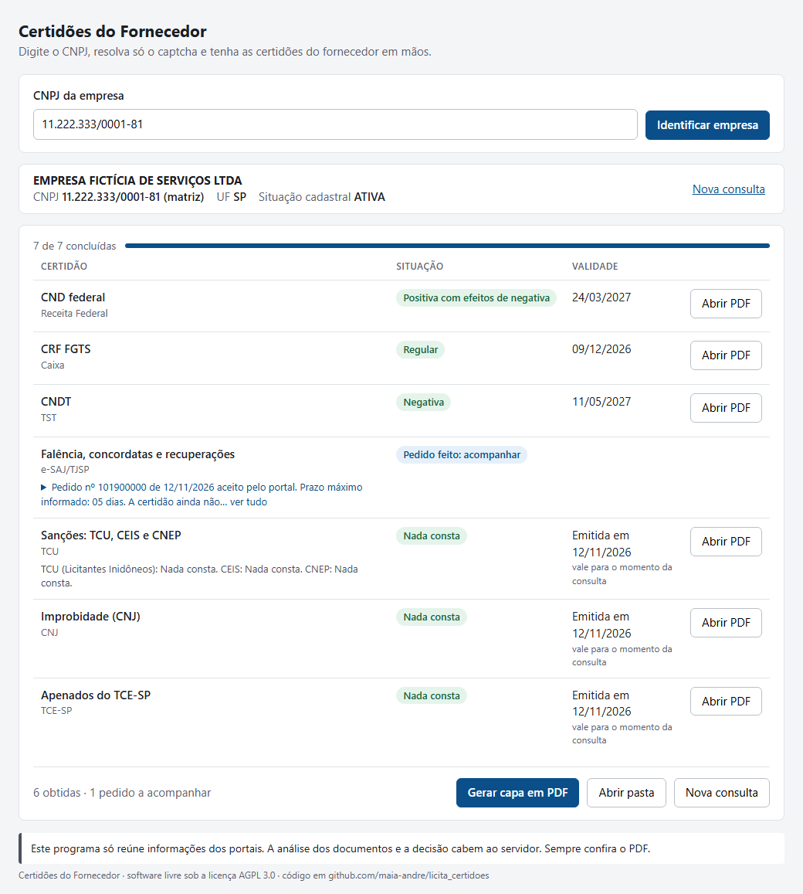
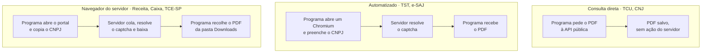

<div align="center">

# 📑 Certidões do Fornecedor

*licita_certidoes*

**Digite o CNPJ, resolva só o captcha e tenha as certidões do fornecedor em mãos.**

Programa local e gratuito para pregoeiros, gestores e fiscais de contratos.

[](https://github.com/maia-andre/licita_certidoes/actions/workflows/testes.yml)
[](https://github.com/maia-andre/licita_certidoes/releases)
[](LICENSE)


</div>

---

## O problema

Em cada habilitação e a cada nota fiscal de contrato, o servidor reúne à mão as certidões de regularidade do fornecedor, em portais diferentes. Para cada uma, redigita o mesmo CNPJ, resolve um captcha, baixa o PDF e confere situação e validade. É um trabalho repetitivo, sujeito a erro de digitação, e que se repete em todo órgão que contrata pela Lei 14.133/2021.

O Certidões do Fornecedor cuida da parte repetitiva e deixa com o servidor o que é dele: **o captcha, o login e a decisão.** O servidor digita o CNPJ uma vez; o programa identifica a empresa, abre cada portal, guarda os PDFs numa pasta do CNPJ e mostra numa só tela a situação e a validade de cada certidão.



## Princípios

- **Sem contornar captcha.** Quem resolve é o servidor, num navegador visível. O programa não usa serviços de terceiros para isso.
- **Sem agregador pago.** As certidões vêm direto dos portais oficiais.
- **Seus dados ficam no seu computador.** Os PDFs são guardados localmente, e a leitura deles não usa IA nem serviços externos.
- **Sem senha guardada.** Senhas, tokens e sessões gov.br não são mantidos entre execuções.
- **A decisão é do servidor.** O programa só reúne informações e não emite juízo de habilitação, inabilitação ou bloqueio de pagamento.

## Certidões disponíveis

Sete certidões em sequência, numa só tela, com o estado de cada uma atualizado durante a consulta.

| # | Certidão | Portal | Modo de acesso | Captcha | O que a tela mostra |
|:-:|---|---|---|---|---|
| 1 | CND federal (Receita/PGFN) | Receita Federal | Navegador do servidor | hCaptcha | Situação e validade |
| 2 | CRF FGTS | Caixa | Navegador do servidor | sim | Situação (Regular) e validade |
| 3 | CNDT | TST | Automatizado | imagem | Situação e validade |
| 5 | Falência, concordatas e recuperações | e-SAJ/TJSP | Automatizado | reCAPTCHA | "Nada consta" e data de emissão, ou "Pedido feito: acompanhar" |
| 7 | Sanções: CEIS, CNEP e inidôneos do TCU | Consulta Consolidada (TCU) | Consulta direta | nenhum | Resultado de cada cadastro e data da consulta |
| 10 | Improbidade administrativa (CNIA) | CNJ | Consulta direta | nenhum | "Nada consta" e data da consulta |
| 8 | Apenados do TCE-SP | Sistema de Apenados (TCE-SP) | Navegador do servidor | Turnstile | "Nada consta" e data da consulta |

A numeração segue a lista da [especificação](docs/spec.md) (RN-01). Os itens 4, 6 e 9 estão [adiados](#caminho-para-as-demais-exigências).

Em todas elas, o programa:

- atende CNPJ de qualquer UF; a certidão cujo portal só atende SP (hoje, a falência pelo e-SAJ) fica "Não se aplica" fora de SP, com a indicação de onde obtê-la;
- valida o CNPJ, numérico ou alfanumérico, antes de qualquer consulta externa, e identifica a empresa na BrasilAPI, com a escolha entre filial e matriz; para filial, pede a CND federal com o CNPJ da matriz, que a Receita exige, e o CRF com o da filial;
- guarda os PDFs numa subpasta por consulta, `Certidoes\<CNPJ>\<data e hora>\` (no Windows, dentro de `C:\Users\<usuário>\`), e abre cada PDF e a pasta pela tela;
- lê do PDF a situação e a validade e avisa quando a certidão está vencida; na dúvida, mostra **"Conferir no PDF"** e nunca presume;
- marca "Falha técnica" quando um portal falha e segue para a próxima certidão;
- destaca no cartão "Sua vez" o que o servidor precisa fazer no portal, com o botão para copiar o CNPJ de novo;
- deixa o servidor pular a certidão em andamento e repetir só a que falhou;
- gera, pelo botão **Gerar capa em PDF**, uma capa para instruir o processo, com a situação, a data e a hora de cada consulta e o código de integridade (SHA-256) de cada certidão.

## Como obtemos cada certidão

Cada portal aceita um tipo de acesso diferente. O programa usa um de três modos e **nunca tenta esconder a automação nem contornar um captcha**.



| Modo | Quando usamos | Portais |
|---|---|---|
| **Consulta direta** | O portal é público, não tem captcha e entrega o PDF por endereço próprio. O programa se identifica de forma genérica, sem dados do usuário. | TCU, CNJ |
| **Automatizado** | O portal aceita navegador automatizado. O programa abre um Chromium visível, preenche o formulário e espera o servidor resolver o captcha. | TST, e-SAJ |
| **Navegador do servidor** | O portal recusa navegador automatizado. O programa abre o portal no navegador normal do servidor e reconhece o PDF baixado pelo nome ou pelo texto e pelo CNPJ. | Receita, Caixa, TCE-SP |

<details>
<summary><b>Por que cada portal está no seu modo</b> (testes de 11 e 12/11/2026)</summary>

- **Receita Federal:** o hCaptcha passa no Chromium automatizado, mas a API responde `CaptchaFalhaValidacao` (código 023). No navegador normal, funciona.
- **Caixa:** o bloqueio de robôs (Radware/ShieldSquare) barrou o primeiro acesso automatizado. Não fazemos novos acessos automatizados, porque a página de bloqueio registra o IP da rede.
- **TCE-SP:** o Cloudflare Turnstile falhou com o erro 600010 nas duas tentativas no Chromium automatizado. No navegador normal, funciona.
- **TST e e-SAJ:** aceitam o Chromium do Playwright. No e-SAJ, o programa preenche o pedido; o servidor confere, resolve o reCAPTCHA e envia. Logo depois, o programa consulta o pedido e baixa a certidão, que costuma sair na hora quando nada consta.
- **TCU:** a página da Consulta Consolidada busca o PDF numa API pública, sem captcha. O programa pede o PDF direto, sem abrir navegador.
- **CNJ:** a consulta de improbidade não tem mais captcha. O programa faz a mesma verificação de condenações que a página faz e baixa a certidão. Virou item próprio porque o TCU respondeu "Sistema do CNJ está indisponível" em todas as 20 consultas da validação, enquanto o site do CNJ funcionava.
- **Portal da Transparência:** não é usado. CEIS e CNEP vêm pelo TCU, porque o portal da CGU pede captcha (AWS WAF).

</details>

## O que os editais pedem

Ponto de partida: as minutas padrão de edital de 2026 da Prefeitura de São José dos Campos (concorrência, aquisição de bens, registro de preços e transporte). Outros órgãos podem ter outras exigências padrão; veja [como contribuir](#como-contribuir).

| Exigência no edital | Em quais minutas | No programa |
|---|---|---|
| CND federal (Receita/PGFN) | todas | Disponível (item 1) |
| CRF FGTS (Caixa) | todas | Disponível (item 2) |
| CNDT (TST) | todas | Disponível (item 3) |
| Falência (distribuidor da sede) | todas | Disponível para SP (item 5, e-SAJ) |
| CEIS (CGU), consulta do pregoeiro | todas | Disponível (item 7, pelo TCU) |
| CNEP (CGU), consulta do pregoeiro | todas | Disponível (item 7, pelo TCU) |
| Relação de Apenados do TCE-SP, consulta do pregoeiro | todas | Disponível (item 8) |
| CND municipal (ISS) da sede | todas, menos uma de aquisição de bens | Adiada (item 9, SJC) |
| CND estadual (ICMS) | todas, menos transporte | Adiada (item 4, gov.br) |
| Inscrição no CNPJ | todas | Parcial: só os dados, pela BrasilAPI |
| Inscrição estadual ou municipal | todas | Fora do escopo atual |
| Certidão simplificada da Junta (ME/EPP) | todas | Fora do escopo (a JUCESP cobra pela certidão) |
| Registro no CREA/CAU | só concorrências de engenharia | Fora do escopo atual |
| Alvará ou licença específica | depende do objeto | Fora do escopo (varia caso a caso) |

## Caminho para as demais exigências

O que falta, o que impede e um caminho possível para cada exigência. Nenhum destes caminhos foi testado; cada um precisa de reconhecimento e de decisão antes de entrar no plano.

| Exigência | O que impede hoje | Caminho possível |
|---|---|---|
| **CND estadual (ICMS)**<br/>SP: Certidão Única do SIDEB | "Emitir eCND" leva ao login gov.br. O programa não automatiza gov.br. | Modo navegador do servidor: o servidor entra no gov.br no próprio navegador, e o programa só recolhe o PDF. Depende de o login do servidor permitir emitir para o CNPJ de terceiro. |
| **CND estadual**<br/>outras UFs | Cada estado tem um portal próprio; em alguns, Fazenda e dívida ativa saem em certidões separadas. | Mapeamento colaborativo na issue [#7](https://github.com/maia-andre/licita_certidoes/issues/7): o programa usa a UF do CNPJ para abrir o portal certo, no modo que cada um aceitar. |
| **Complemento cível**<br/>eproc/TJSP | O pedido exige gov.br nível ouro ou prata. | O servidor faz o pedido no próprio navegador, com o gov.br dele. A página de download (número do pedido e CNPJ) é aberta e poderia ser consultada pelo programa, como já se faz no e-SAJ. |
| **CND municipal (ISS)**<br/>São José dos Campos | O sistema tributário migrou em 11/2026 para o iiTributário, que ainda não oferece a CND mobiliária. | O iiTributário tem, em outros municípios, uma consulta pública por CNPJ e motivo do pedido que gera o PDF. Quando estiver disponível em SJC, deve caber no modo automatizado ou no navegador do servidor. |
| **CND municipal**<br/>outros municípios | Cada prefeitura tem um portal próprio. | Um catálogo de portais municipais, mapeado com a ajuda de colaboradores de cada município na issue [#6](https://github.com/maia-andre/licita_certidoes/issues/6): o programa usa o município da sede (BrasilAPI) para abrir o portal certo, no modo que cada um aceitar. |
| **Inscrição no CNPJ** | Os dados já vêm da BrasilAPI, mas o comprovante oficial é da Receita, com captcha. | Modo navegador do servidor, como a CND federal. |
| **Inscrição estadual** | Não foi feito reconhecimento. | Verificar a consulta pública do Cadesp/Sintegra. Se tiver captcha, modo navegador do servidor. |
| **Inscrição municipal** | Cada prefeitura tem a sua. | O mesmo catálogo da CND municipal. |
| **Certidão simplificada da Junta** | A JUCESP cobra pela certidão. | Fica com o fornecedor. O programa não paga taxas nem usa agregador pago. |
| **CREA/CAU** | Só nas concorrências de engenharia; não foi feito reconhecimento. | Verificar as consultas públicas de registro de empresa dos conselhos. |
| **Alvarás e licenças** | Dependem do objeto e do órgão emissor. | Fica fora: o servidor confere o documento apresentado pelo fornecedor. |

## Como rodar

### Windows (plataforma principal)

Testado no Windows 11 com Python 3.14. A tela usa o WebView2 do Edge, que já vem com o sistema.

```powershell
git clone https://github.com/maia-andre/licita_certidoes.git
cd licita_certidoes

py -m venv .venv
.venv\Scripts\python -m pip install -r requirements.txt
.venv\Scripts\python -m playwright install chromium

.venv\Scripts\python -m certidoes
```

> [!TIP]
> Use `py`, e não `python`: no Windows, `python` pode abrir o atalho da Microsoft Store em vez do Python instalado.

Os testes usam um portal falso local e não acessam os portais reais. O GitHub Actions roda a suíte no Windows a cada push.

```powershell
.venv\Scripts\python -m pytest -q
```

<details>
<summary><b>Linux (alternativa)</b></summary>

Testado no Debian. A tela usa o GTK e o WebKit do sistema, por isso o venv precisa do Python do sistema e de `--system-site-packages`.

```bash
sudo apt install python3-gi gir1.2-gtk-3.0 gir1.2-webkit2-4.1

/usr/bin/python3 -m venv --system-site-packages .venv
.venv/bin/pip install -r requirements.txt
.venv/bin/python -m playwright install chromium

.venv/bin/python -m certidoes
.venv/bin/python -m pytest -q
```

</details>

## Versões e marcos

As notas de cada versão estão em [Releases](https://github.com/maia-andre/licita_certidoes/releases), e o andamento de cada marco, com as issues pendentes, em [Milestones](https://github.com/maia-andre/licita_certidoes/milestones).

| Versão | Data | Conteúdo |
|---|---|---|
| **v0.1.0** · Fluxo básico | 11/11/2026 | CND federal, CRF e CNDT em sequência; leitura de situação e validade; identificação pela BrasilAPI; pular e repetir |
| **v0.2.0** · Certidões das minutas | 12/11/2026 | Falência no e-SAJ, sanções pelo TCU e apenados do TCE-SP |
| **v0.3.0** · Validada, com tela nova e capa | 12/11/2026 | Validação com 10 CNPJs reais e correções; improbidade no CNJ; CNPJ de qualquer UF; CND de filial pela matriz; tela revisada; subpasta por consulta e capa em PDF |
| **v1.0.0** *(planejada)* | — | Instalação sem Python (executável para Windows) |

| Marco | Incrementos | Situação |
|---|---|---|
| **1 · Fluxo básico** | INC-01 a INC-05 e INC-07 | Concluído em 11/11/2026 |
| **2 · Certidões das minutas** | INC-08, INC-11 e INC-12 | Concluído em 12/11/2026 |
| **3 · Validação** | INC-10, INC-14 e INC-15 | Concluído em 12/11/2026 (release v0.3.0) |
| **4 · Certidões com login** | INC-06 (SIDEB), INC-09 (eproc) e INC-13 (CND de SJC) | Adiado: gov.br e sistema municipal em implantação |

<details>
<summary><b>Todos os incrementos</b></summary>

| # | Incremento | Entrega | Situação |
|---|---|---|---|
| 01 | CNDT de ponta a ponta | CNPJ, captcha, PDF salvo e aberto pela tela | Concluído |
| 02 | CND federal e sequência de itens | CNDT e CND em sequência, com o estado de cada item | Concluído |
| 03 | CRF FGTS | CRF obtido ou "Não emitida" com a mensagem do portal | Concluído |
| 04 | Situação e validade na tela | Dados lidos do PDF, ou "Conferir no PDF" | Concluído |
| 05 | Identificação da empresa | Dados da BrasilAPI e escolha entre filial e matriz | Concluído |
| 06 | Certidão Única estadual | Emissão pelo SIDEB | Adiado: exige login gov.br |
| 07 | Pular e repetir itens | Refazer só o item que falhou | Concluído |
| 08 | Falência no e-SAJ | Pedido enviado e certidão baixada, se já liberada | Concluído |
| 09 | Complemento no eproc | Pedido com gov.br | Adiado: exige login gov.br |
| 10 | Validação com CNPJs reais | Resultado de 10 CNPJs conferido com os PDFs | Concluído |
| 11 | Sanções no TCU | CEIS, CNEP, TCU e CNJ num PDF, com o resultado de cada cadastro | Concluído |
| 12 | Apenados do TCE-SP | Certidão no navegador do servidor, com a situação lida | Concluído |
| 13 | CND municipal de SJC | CND mobiliária para empresas com sede em SJC | Adiado: sistema em implantação |
| 14 | Improbidade no CNJ | Certidão do CNIA por consulta direta | Concluído |
| 15 | Tela revisada e capa | Cartão "Sua vez", etiquetas por situação, subpasta por consulta e capa em PDF | Concluído |

</details>

## Como contribuir

O programa nasceu para a rotina de uma prefeitura, mas a dor é a mesma em qualquer órgão que contrata pela Lei 14.133/2021. As certidões federais servem a todos; o que muda de um lugar para outro são os **portais estadual e municipal** e a **lista de exigências padrão** de cada órgão. Essas coisas se mapeiam muito mais rápido em conjunto.

- **CND municipal do seu município:** formulário [CND municipal do meu município](https://github.com/maia-andre/licita_certidoes/issues/new?template=cnd-municipal.yml), com andamento na issue [#6](https://github.com/maia-andre/licita_certidoes/issues/6).
- **CND estadual do seu estado:** formulário [CND estadual do meu estado](https://github.com/maia-andre/licita_certidoes/issues/new?template=cnd-estadual.yml), com andamento na issue [#7](https://github.com/maia-andre/licita_certidoes/issues/7).
- **Exigências, erros e código:** veja o [guia de contribuição](CONTRIBUTING.md), com as regras que todo portal novo precisa seguir.

Ao participar, você concorda com o [Código de Conduta](CODE_OF_CONDUCT.md). Vulnerabilidades seguem a [política de segurança](SECURITY.md).

## Documentação

- [Especificação](docs/spec.md): requisitos, regras de negócio e casos extremos
- [Plano](docs/plan.md): backlog de incrementos e revisões do plano
- [Relatório de construção](docs/build-report.md) e [relatório de verificação](docs/verify-report.md) do incremento atual

## Mantenedor

**André Maia** ([@maia-andre](https://github.com/maia-andre)), Prefeitura de São José dos Campos.

Dúvidas e propostas pelas [issues](https://github.com/maia-andre/licita_certidoes/issues); assuntos que não cabem numa issue pública, pelo e-mail andre.maia@sjc.sp.gov.br. O projeto não tem suporte formal, e as respostas podem levar alguns dias.

## Aviso

Este programa só reúne informações e não substitui a análise do servidor. Sempre confira o documento emitido. O projeto não tem vínculo com os portais consultados.

## Licença

Copyright (C) 2026 Município de São José dos Campos. Desenvolvido por André Maia.

Software livre sob a [GNU Affero General Public License, versão 3](LICENSE) (AGPL 3.0). Na prática:

- **Pode** usar, estudar, copiar, modificar e redistribuir o programa, inclusive em outros órgãos, sem pedir autorização.
- **Pode** adaptar o programa e usá-lo internamente sem publicar nada.
- **Precisa**, ao distribuir uma versão modificada ou oferecê-la como serviço pela rede, publicar o código-fonte dessa versão sob a mesma licença, mantendo os avisos de autoria.

Assim, as melhorias feitas por outros municípios voltam abertas para todos. O texto da licença, em inglês, é o único com valor jurídico.
