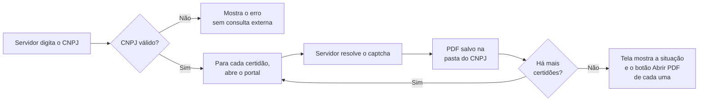

<div align="center">

# licita_certidoes

**Digite o CNPJ, resolva só o captcha e tenha a certidão do fornecedor em mãos.**

Programa local e gratuito para pregoeiros, gestores e fiscais de contratos.


</div>

---

## O problema

Em cada habilitação e a cada nota fiscal de contrato, o servidor reúne à mão as certidões de regularidade do fornecedor, em portais diferentes: redigita o mesmo CNPJ, resolve um captcha por portal, baixa os PDFs e confere situação e validade.

O `licita_certidoes` cuida da parte repetitiva e deixa com o servidor o que é dele: o captcha, o login e a decisão.

## Como funciona



O programa abre cada portal de um de dois jeitos:

- **Automatizado:** abre um Chromium à parte, preenche o CNPJ e recebe o PDF. O servidor só resolve o captcha. Usado no TST.
- **No navegador do servidor:** alguns portais recusam navegador automatizado. Nesses, o programa abre o portal no navegador normal do servidor e copia o CNPJ. O servidor cola, resolve o captcha e baixa o PDF, e o programa o recolhe da pasta Downloads. Usado na Receita Federal e na Caixa.

## O que já funciona

Hoje o programa emite **três** certidões em sequência: a CND federal, o CRF do FGTS e a CNDT. A primeira sequência real foi feita no Windows em 11/11/2026.

- Valida o CNPJ, numérico ou alfanumérico, antes de qualquer consulta externa.
- Mostra cada certidão numa tabela, com o estado atualizado durante a consulta.
- Se um portal falhar, marca "Falha técnica" e segue para a próxima certidão.
- Guarda os PDFs na pasta `Certidoes\<CNPJ>\` do usuário (no Windows, `C:\Users\<usuário>\Certidoes\`).
- Abre cada PDF pela própria tela.

## Certidões previstas

A primeira versão atende empresas com CNPJ de SP.

| Certidão | Portal | Situação |
|---|---|---|
| CND federal | Receita Federal | ✅ Funcionando (no navegador do servidor) |
| CNDT | TST | ✅ Funcionando |
| CRF FGTS | Caixa | ✅ Funcionando (no navegador do servidor) |
| Certidão Única estadual | SIDEB (Sefaz-SP/PGE-SP) | Planejada |
| Falência, concordatas e recuperações | e-SAJ/TJSP | Planejada, com pedido assistido |
| Complemento cível de primeiro grau | eproc/TJSP | Planejada, com pedido assistido |

## Princípios

- **Sem contornar captcha.** Quem resolve é o servidor, no navegador visível. O programa não usa serviços de terceiros para isso.
- **Sem agregador pago.** As certidões vêm direto dos portais oficiais.
- **Seus dados ficam no seu computador.** Os PDFs são guardados localmente, e a leitura deles não usará IA nem serviços externos.
- **Sem senha guardada.** Senhas, tokens e sessões gov.br não serão mantidos entre execuções.
- **A decisão é do servidor.** O programa só reúne informações e não emite juízo de habilitação, inabilitação ou bloqueio de pagamento.

## Como rodar

### Windows (plataforma principal)

Testado no Windows 11 com Python 3.14. A tela usa o WebView2 do Edge, que já vem com o sistema.

```powershell
git clone https://github.com/maia-andre/licita_certidoes.git
cd licita_certidoes

py -m venv .venv
.venv\Scripts\python -m pip install -r requirements.txt
.venv\Scripts\python -m playwright install chromium

.venv\Scripts\python -m certidoes
```

Use `py`, e não `python`: no Windows, `python` pode abrir o atalho da Microsoft Store em vez do Python instalado.

Para rodar os testes, que usam um portal falso local e não acessam os portais reais:

```powershell
.venv\Scripts\python -m pytest -q
```

### Linux (alternativa)

Testado no Debian. A tela usa o GTK e o WebKit do sistema, por isso o venv precisa do Python do sistema e de `--system-site-packages`.

```bash
sudo apt install python3-gi gir1.2-gtk-3.0 gir1.2-webkit2-4.1

/usr/bin/python3 -m venv --system-site-packages .venv
.venv/bin/pip install -r requirements.txt
.venv/bin/python -m playwright install chromium

.venv/bin/python -m certidoes
.venv/bin/python -m pytest -q
```

## Roadmap

| # | Incremento | Entrega | Situação |
|---|---|---|---|
| 01 | CNDT de ponta a ponta | CNPJ, captcha, PDF salvo e aberto pela tela | ✅ Concluído |
| 02 | CND federal e sequência de itens | CNDT e CND em sequência, com o estado de cada item | ✅ Concluído |
| 03 | CRF FGTS | CRF obtido ou "Não emitida" com a mensagem do portal | ✅ Concluído |
| 04 | Situação e validade na tela | Dados lidos do PDF, ou "Conferir no PDF" | ⏭️ Próximo |
| 05 | Identificação da empresa | Dados da BrasilAPI, escolha de filial e recusa fora de SP | Pendente |
| 06 | Certidão Única estadual | Emissão pelo SIDEB | Pendente |
| 07 | Pular e repetir itens | Refazer só o item que falhou | Pendente |
| 08 | Falência no e-SAJ | Pedido enviado e item em "Pedido feito: acompanhar" | Pendente |
| 09 | Complemento no eproc | Pedido com gov.br e os seis itens na tela | Pendente |
| 10 | Validação com CNPJs reais | Resultado de 10 CNPJs de SP conferido com os PDFs | Pendente |

Receita e Caixa recusam navegador automatizado (a Caixa bloqueia já no primeiro acesso). Por isso, a CND federal e o CRF são emitidos no navegador normal do servidor, sem contornar a recusa. Quando o portal não emite, o servidor informa pela tela, com o botão "O portal não emitiu".

## Documentação

- [Especificação](docs/spec.md): requisitos, regras de negócio e casos extremos
- [Plano](docs/plan.md): backlog completo de incrementos
- [Relatório de construção](docs/build-report.md) e [relatório de verificação](docs/verify-report.md) do incremento atual

## Licença

Ainda não definida. Até lá, o código está visível, mas sem permissão formal de reutilização.

## Aviso

Este programa só reúne informações e não substitui a análise do servidor. Sempre confira o documento emitido. O projeto não tem vínculo com os portais consultados.
