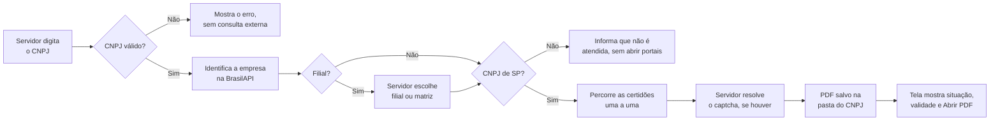
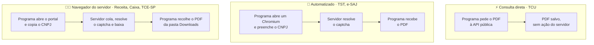
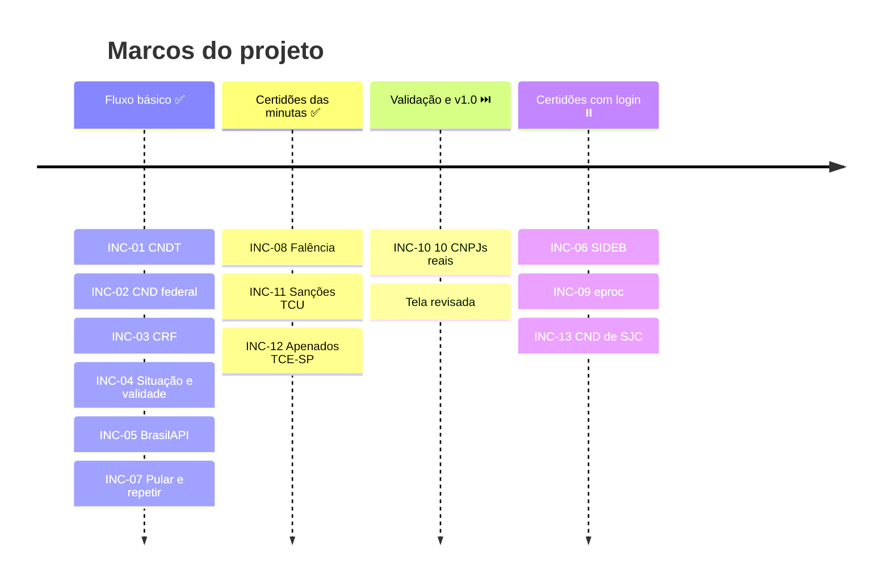

<div align="center">

# 📑 licita_certidoes

**Digite o CNPJ, resolva só o captcha e tenha as certidões do fornecedor em mãos.**

Programa local e gratuito para pregoeiros, gestores e fiscais de contratos.


<br>


[O problema](#-o-problema) ·
[Certidões](#-certidões-que-o-programa-obtém) ·
[O que os editais pedem](#-o-que-os-editais-pedem) ·
[Como obtemos](#-como-obtemos-cada-certidão) ·
[Caminho para as demais](#-caminho-para-as-demais-exigências) ·
[Versões e marcos](#-versões-e-marcos) ·
[Como rodar](#-como-rodar)

</div>

---

## 🎯 O problema

Em cada habilitação e a cada nota fiscal de contrato, o servidor reúne à mão as certidões de regularidade do fornecedor, em portais diferentes. Para cada uma, redigita o mesmo CNPJ, resolve um captcha, baixa o PDF e confere situação e validade.

O `licita_certidoes` cuida da parte repetitiva e deixa com o servidor o que é dele: **o captcha, o login e a decisão.**



## ✅ Certidões que o programa obtém

Seis certidões em sequência, numa só tela, com o estado de cada uma atualizado durante a consulta.

| # | Certidão | Portal | Modo | Captcha | O que a tela mostra |
|:-:|---|---|---|---|---|
| 1 | CND federal (Receita/PGFN) | Receita Federal | 🧑‍💻 Navegador do servidor | hCaptcha | Situação e validade |
| 2 | CRF FGTS | Caixa | 🧑‍💻 Navegador do servidor | sim | Situação (Regular) e validade |
| 3 | CNDT | TST | 🤖 Automatizado | imagem | Situação e validade |
| 5 | Falência, concordatas e recuperações | e-SAJ/TJSP | 🤖 Automatizado | reCAPTCHA | "Nada consta" e data de emissão, ou "Pedido feito: acompanhar" |
| 7 | Sanções: CEIS, CNEP, inidôneos do TCU e improbidade (CNJ) | Consulta Consolidada (TCU) | ⚡ Consulta direta | nenhum | Resultado de cada cadastro e data da consulta |
| 8 | Apenados do TCE-SP | Sistema de Apenados (TCE-SP) | 🧑‍💻 Navegador do servidor | Turnstile | "Nada consta" e validade |

A numeração segue a lista da [especificação](docs/spec.md) (RN-01). Os itens 4, 6 e 9 estão [adiados](#-caminho-para-as-demais-exigências).

**Em todas elas, o programa:**
- valida o CNPJ, numérico ou alfanumérico, antes de qualquer consulta externa;
- guarda o PDF em `Certidoes\<CNPJ>\` (no Windows, `C:\Users\<usuário>\Certidoes\`) e o abre pela tela;
- lê do PDF a situação e a validade e avisa quando a certidão está vencida; na dúvida, mostra **"Conferir no PDF"** e nunca presume;
- marca "Falha técnica" quando um portal falha e segue para a próxima certidão;
- deixa o servidor pular a certidão em andamento e repetir só a que falhou.

## 📋 O que os editais pedem

Levantamento feito nas minutas padrão de edital de 2026 da Prefeitura de São José dos Campos: concorrência (5 variantes), aquisição de bens (3), registro de preços e transporte. Foram lidas 10 das 16 minutas.

| Exigência no edital | Em quais minutas | No programa |
|---|---|---|
| CND federal (Receita/PGFN) | todas | ✅ Item 1 |
| CRF FGTS (Caixa) | todas | ✅ Item 2 |
| CNDT (TST) | todas | ✅ Item 3 |
| Falência (distribuidor da sede) | todas | ✅ Item 5 (e-SAJ) |
| CEIS (CGU), consulta do pregoeiro | todas | ✅ Item 7 (pelo TCU) |
| CNEP (CGU), consulta do pregoeiro | todas | ✅ Item 7 (pelo TCU) |
| Relação de Apenados do TCE-SP, consulta do pregoeiro | todas | ✅ Item 8 |
| CND municipal (ISS) da sede | todas, menos uma de aquisição de bens | ⏸️ Item 9, adiado (SJC) |
| CND estadual (ICMS) | todas, menos transporte | ⏸️ Item 4, adiado (gov.br) |
| Inscrição no CNPJ | todas | 🔹 Só os dados, pela BrasilAPI |
| Inscrição estadual ou municipal | todas | ⬜ Fora do escopo atual |
| Certidão simplificada da Junta (ME/EPP) | todas | ⬜ Fora (a JUCESP cobra pela certidão) |
| Registro no CREA/CAU | só concorrências de engenharia | ⬜ Fora do escopo atual |
| Alvará ou licença específica | depende do objeto | ⬜ Fora (varia caso a caso) |

> [!NOTE]
> As 6 minutas não lidas (serviço, serviço de engenharia, locação e transporte escolar) não abriram nesta máquina por falta de memória. A habilitação delas provavelmente segue o mesmo padrão, mas isso não foi conferido.

## 🔧 Como obtemos cada certidão

Cada portal aceita um tipo de acesso diferente. O programa usa um de três modos e **nunca tenta esconder a automação nem contornar um captcha**.



| Modo | Quando usamos | Portais |
|---|---|---|
| ⚡ **Consulta direta** | O portal é público, não tem captcha e entrega o PDF por endereço próprio. O programa se identifica de forma genérica, sem dados do usuário. | TCU |
| 🤖 **Automatizado** | O portal aceita navegador automatizado. O programa abre um Chromium visível, preenche o formulário e espera o servidor resolver o captcha. | TST, e-SAJ |
| 🧑‍💻 **Navegador do servidor** | O portal recusa navegador automatizado. O programa abre o portal no navegador normal do servidor e reconhece o PDF baixado pelo nome ou pelo texto e pelo CNPJ. | Receita, Caixa, TCE-SP |

<details>
<summary><b>Por que cada portal está no seu modo</b> (testes de 11 e 12/11/2026)</summary>

- **Receita Federal:** o hCaptcha passa no Chromium automatizado, mas a API responde `CaptchaFalhaValidacao` (código 023). No navegador normal, funciona.
- **Caixa:** o bloqueio de robôs (Radware/ShieldSquare) barrou o primeiro acesso automatizado. Não fazemos novos acessos automatizados, porque a página de bloqueio registra o IP da rede.
- **TCE-SP:** o Cloudflare Turnstile falhou com o erro 600010 nas duas tentativas no Chromium automatizado. No navegador normal, funciona.
- **TST e e-SAJ:** aceitam o Chromium do Playwright. No e-SAJ, o programa preenche o pedido; o servidor confere, resolve o reCAPTCHA e envia. Logo depois, o programa consulta o pedido e baixa a certidão, que costuma sair na hora quando nada consta.
- **TCU:** a página da Consulta Consolidada busca o PDF numa API pública, sem captcha. O programa pede o PDF direto, sem abrir navegador.
- **Portal da Transparência:** não é usado. CEIS e CNEP vêm pelo TCU, porque o portal da CGU pede captcha (AWS WAF).

</details>

## 🧭 Caminho para as demais exigências

O que falta, o que impede e um caminho possível para cada exigência. Nenhum destes caminhos foi testado; cada um precisa de reconhecimento e de decisão antes de entrar no plano.

| Exigência | O que impede hoje | Caminho possível |
|---|---|---|
| **CND estadual (ICMS)**<br/>Certidão Única do SIDEB | "Emitir eCND" leva ao login gov.br. O programa não automatiza gov.br. | Modo navegador do servidor: o servidor entra no gov.br no próprio navegador, e o programa só recolhe o PDF. Depende de o login do servidor permitir emitir para o CNPJ de terceiro. |
| **Complemento cível**<br/>eproc/TJSP | O pedido exige gov.br nível ouro ou prata. | O servidor faz o pedido no próprio navegador, com o gov.br dele. A página de download (número do pedido e CNPJ) é aberta e poderia ser consultada pelo programa, como já se faz no e-SAJ. |
| **CND municipal (ISS)**<br/>São José dos Campos | O sistema tributário migrou em 11/2026 para o iiTributário, que ainda não oferece a CND mobiliária. | O iiTributário tem, em outros municípios, uma consulta pública por CNPJ e motivo do pedido que gera o PDF. Quando estiver disponível em SJC, deve caber no modo automatizado ou no navegador do servidor. |
| **CND municipal**<br/>outros municípios | Cada prefeitura tem um portal próprio. | Um catálogo com o link da prefeitura da sede (o município vem da BrasilAPI), começando pelas cidades mais frequentes entre os fornecedores, no modo navegador do servidor. |
| **Inscrição no CNPJ** | Os dados já vêm da BrasilAPI, mas o comprovante oficial é da Receita, com captcha. | Modo navegador do servidor, como a CND federal. |
| **Inscrição estadual** | Não foi feito reconhecimento. | Verificar a consulta pública do Cadesp/Sintegra. Se tiver captcha, modo navegador do servidor. |
| **Inscrição municipal** | Cada prefeitura tem a sua. | O mesmo catálogo da CND municipal. |
| **Certidão simplificada da Junta** | A JUCESP cobra pela certidão. | Fica com o fornecedor. O programa não paga taxas nem usa agregador pago. |
| **CREA/CAU** | Só nas concorrências de engenharia; não foi feito reconhecimento. | Verificar as consultas públicas de registro de empresa dos conselhos. |
| **Alvarás e licenças** | Dependem do objeto e do órgão emissor. | Fica fora: o servidor confere o documento apresentado pelo fornecedor. |

## 🚀 Versões e marcos

### Versões

| Versão | Data | Conteúdo |
|---|---|---|
| **v0.1.0** · Fluxo básico | 11/11/2026 | CND federal, CRF e CNDT em sequência; leitura de situação e validade; identificação pela BrasilAPI; pular e repetir |
| **v0.2.0** · Certidões das minutas | 12/11/2026 | Falência no e-SAJ, sanções pelo TCU e apenados do TCE-SP |
| **v1.0.0** · Validada *(planejada)* | — | Validação com 10 CNPJs reais de SP e tela revisada |

### Marcos



| Marco | Incrementos | Situação |
|---|---|---|
| **1 · Fluxo básico** | INC-01 a INC-05 e INC-07 | ✅ Concluído em 11/11/2026 |
| **2 · Certidões das minutas** | INC-08, INC-11 e INC-12 | ✅ Concluído em 12/11/2026 |
| **3 · Validação e v1.0** | INC-10 e revisão da tela | ⏭️ Próximo |
| **4 · Certidões com login** | INC-06 (SIDEB), INC-09 (eproc) e INC-13 (CND de SJC) | ⏸️ Adiado: gov.br e sistema municipal em implantação |

<details>
<summary><b>Todos os incrementos</b></summary>

| # | Incremento | Entrega | Situação |
|---|---|---|---|
| 01 | CNDT de ponta a ponta | CNPJ, captcha, PDF salvo e aberto pela tela | ✅ |
| 02 | CND federal e sequência de itens | CNDT e CND em sequência, com o estado de cada item | ✅ |
| 03 | CRF FGTS | CRF obtido ou "Não emitida" com a mensagem do portal | ✅ |
| 04 | Situação e validade na tela | Dados lidos do PDF, ou "Conferir no PDF" | ✅ |
| 05 | Identificação da empresa | Dados da BrasilAPI, escolha de filial e recusa fora de SP | ✅ |
| 06 | Certidão Única estadual | Emissão pelo SIDEB | ⏸️ Exige login gov.br |
| 07 | Pular e repetir itens | Refazer só o item que falhou | ✅ |
| 08 | Falência no e-SAJ | Pedido enviado e certidão baixada, se já liberada | ✅ |
| 09 | Complemento no eproc | Pedido com gov.br | ⏸️ Exige login gov.br |
| 10 | Validação com CNPJs reais | Resultado de 10 CNPJs de SP conferido com os PDFs | ⏭️ Próximo |
| 11 | Sanções no TCU | CEIS, CNEP, TCU e CNJ num PDF, com o resultado de cada cadastro | ✅ |
| 12 | Apenados do TCE-SP | Certidão no navegador do servidor, com a situação lida | ✅ |
| 13 | CND municipal de SJC | CND mobiliária para empresas com sede em SJC | ⏸️ Sistema em implantação |

</details>

## 🛡️ Princípios

- **Sem contornar captcha.** Quem resolve é o servidor, num navegador visível. O programa não usa serviços de terceiros para isso.
- **Sem agregador pago.** As certidões vêm direto dos portais oficiais.
- **Seus dados ficam no seu computador.** Os PDFs são guardados localmente, e a leitura deles não usa IA nem serviços externos.
- **Sem senha guardada.** Senhas, tokens e sessões gov.br não são mantidos entre execuções.
- **A decisão é do servidor.** O programa só reúne informações e não emite juízo de habilitação, inabilitação ou bloqueio de pagamento (Lei 14.133/2021).

## 💻 Como rodar

### Windows (plataforma principal)

Testado no Windows 11 com Python 3.14. A tela usa o WebView2 do Edge, que já vem com o sistema.

```powershell
git clone https://github.com/maia-andre/licita_certidoes.git
cd licita_certidoes

py -m venv .venv
.venv\Scripts\python -m pip install -r requirements.txt
.venv\Scripts\python -m playwright install chromium

.venv\Scripts\python -m certidoes
```

> [!TIP]
> Use `py`, e não `python`: no Windows, `python` pode abrir o atalho da Microsoft Store em vez do Python instalado.

Os testes usam um portal falso local e não acessam os portais reais:

```powershell
.venv\Scripts\python -m pytest -q
```

<details>
<summary><b>Linux (alternativa)</b></summary>

Testado no Debian. A tela usa o GTK e o WebKit do sistema, por isso o venv precisa do Python do sistema e de `--system-site-packages`.

```bash
sudo apt install python3-gi gir1.2-gtk-3.0 gir1.2-webkit2-4.1

/usr/bin/python3 -m venv --system-site-packages .venv
.venv/bin/pip install -r requirements.txt
.venv/bin/python -m playwright install chromium

.venv/bin/python -m certidoes
.venv/bin/python -m pytest -q
```

</details>

## 📚 Documentação

- [Especificação](docs/spec.md): requisitos, regras de negócio e casos extremos
- [Plano](docs/plan.md): backlog de incrementos e revisões do plano
- [Relatório de construção](docs/build-report.md) e [relatório de verificação](docs/verify-report.md) do incremento atual

## ⚖️ Licença

Ainda não definida. Até lá, o código está visível, mas sem permissão formal de reutilização.

## ⚠️ Aviso

Este programa só reúne informações e não substitui a análise do servidor. Sempre confira o documento emitido. O projeto não tem vínculo com os portais consultados.
